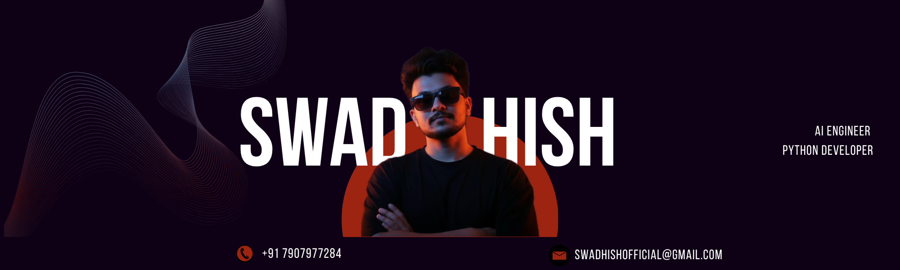

<!-- ============================== PROFILE BANNER ============================== -->

<p align="center">
  
</p>

<!-- ============================== ANIMATED INTRO ============================== -->

<div align="center">

<a href="https://git.io/typing-svg">
  
</a>

<br/>


<a href="https://linkedin.com/in/swadhishks">
  
</a>

<a href="mailto:swadhishofficial@gmail.com">
  
</a>


</div>


<!-- ============================== ABOUT ME ============================== -->

## 👨‍💻 About Me

<table>
<tr>
<td width="58%" valign="top">

```python
class Swadhish:
    role = "AI/ML Engineer | Python Developer"
    location = "Kerala, India 🇮🇳"
    education = "B.Tech CSE"

    stack = [
        "Python",
        "FastAPI",
        "Django",
        "TensorFlow",
        "PyTorch",
        "OpenCV"
    ]

    interests = [
        "Artificial Intelligence",
        "Machine Learning",
        "Backend Development",
        "Computer Vision",
        "NLP",
        "Generative AI"
    ]

    mission = "Build intelligent solutions that solve real-world problems."
```

I'm a **Python Developer and AI/ML Engineer** passionate about building intelligent applications and scalable backend systems.

I have hands-on experience working with **Python, FastAPI, Django, Machine Learning, Deep Learning, NLP and Computer Vision**.

I enjoy transforming ideas into practical software solutions, developing AI-powered applications and exploring emerging technologies.

</td>

<td width="42%" align="center" valign="middle">


</td>
</tr>
</table>

### 🌱 Currently Exploring

<div align="center">


</div>

<!-- ============================== TECH STACK ============================== -->

## 🛠️ Tech Stack

<div align="center">

### 💻 Programming Languages


<br/>
<sub>Python · JavaScript · HTML5 · C++ · SQL</sub>

<br/><br/>

### ⚙️ Backend & Frameworks


<br/>
<sub>FastAPI · Django · Flask · React · REST APIs</sub>

<br/><br/>

### 🤖 AI / Machine Learning


<br/><br/>


<br/><br/>

### 📊 Data Science & Databases


<br/>
<sub>NumPy · Pandas · PostgreSQL · MySQL · MongoDB</sub>

<br/><br/>

### 🧰 Tools & Development


<br/>
<sub>Git · GitHub · VS Code · Postman · Docker</sub>

</div>

<!-- ============================== EXPERIENCE ============================== -->

## 💼 Experience

### 🏢 AI/ML Engineer Intern

**Cyber Square Professional**

📍 Calicut, Kerala, India

📅 July 2025 – March 2026

- 🚀 Developed AI-powered applications and REST APIs using Python, FastAPI, TensorFlow, PyTorch and OpenCV.
- ⚙️ Worked on machine learning pipelines involving data preprocessing, feature engineering, model training and inference.
- 🎯 Developed practical AI solutions, including an ATS Resume Analyzer, Face Recognition System and House Price Prediction.

**Technologies:**


---

<!-- ============================== PROJECTS ============================== -->

## 🚀 Featured Projects

<table>
<tr>

<td width="33%" valign="top">

### 📄 AI Resume Analyzer

AI-powered ATS resume analyzer for resume parsing, job matching and evaluation.

**Key Features:**

- PDF, DOCX and image resume processing.
- NLP and OCR-based information extraction.
- Job description matching and ATS scoring.
- AI-powered resume recommendations.

**Tech Stack:**


[](https://github.com/swadhishks)

</td>

<td width="33%" valign="top">

### 🎙️ Voice-to-Code AI Web

An AI-powered application that converts voice commands into executable programming code.

**Key Features:**

- Voice-based coding assistance.
- Speech-to-text processing.
- AI-based code generation.
- Hands-free programming interface.

**Tech Stack:**


[](https://github.com/swadhishks)

</td>

<td width="33%" valign="top">

### 🙂 Face Recognition System

Real-time face detection and recognition application using OpenCV and LBPH.

**Key Features:**

- Real-time webcam face detection.
- Face dataset preprocessing.
- LBPH model training.
- Face recognition under varying lighting conditions.

**Tech Stack:**


[](https://github.com/swadhishks)

</td>

</tr>
</table>

---

<!-- ============================== GITHUB ANALYTICS ============================== -->

## 📊 GitHub Analytics

<div align="center">


<br/><br/>


<br/><br/>


</div>

---

<!-- ============================== EDUCATION ============================== -->

## 🎓 Education

**APJ Abdul Kalam Technological University, Kerala**

Bachelor of Technology (B.Tech)

Computer Science and Engineering

`2021 – 2025`

---

<!-- ============================== LANGUAGES ============================== -->

## 🌐 Languages

<div align="center">


</div>

---

<!-- ============================== CONTACT ============================== -->

## 📬 Let's Connect

<div align="center">

<a href="https://linkedin.com/in/swadhishks">
  
</a>

<a href="mailto:swadhishofficial@gmail.com">
  
</a>

<a href="https://github.com/swadhishks">
  
</a>

<br/><br/>


<br/><br/>

**Thanks for visiting my profile!**

⭐ Feel free to explore my repositories and connect with me.

</div>


